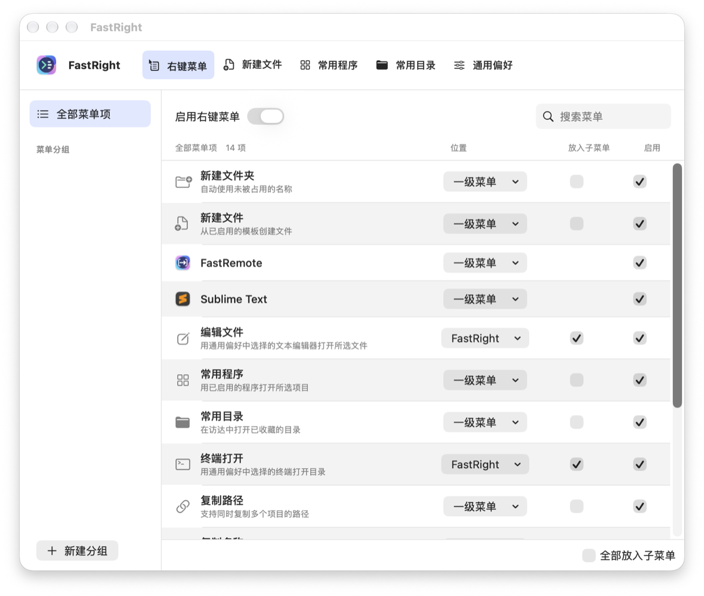
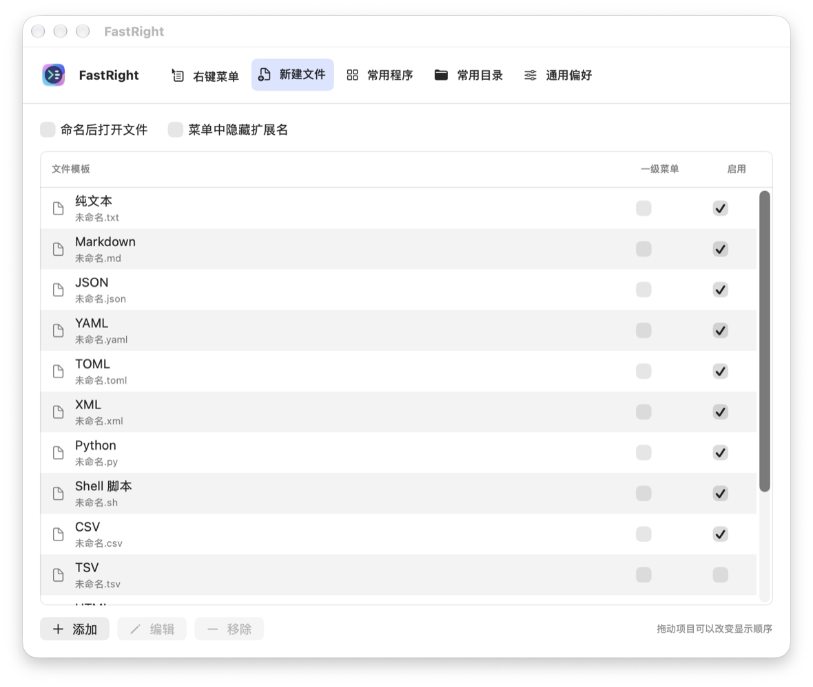
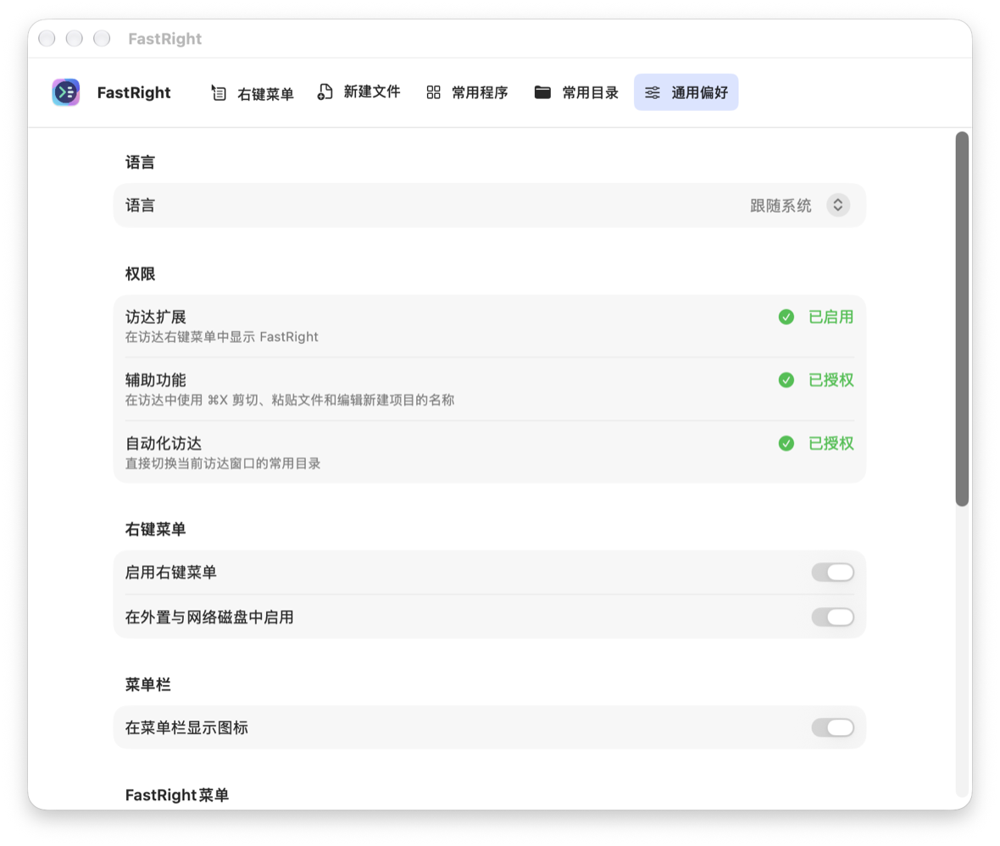

# FastRight

FastRight 为 macOS 访达提供可自定义的右键菜单，并可把常用操作放到菜单栏。支持简体中文和 English。

- 新建文件夹，或从模板新建文件。
- 收藏常用应用和目录，配置菜单分组、排序和图标。
- 用指定编辑器或终端打开项目，复制路径、名称或文件哈希。

## 截图 / Screenshots

| 右键菜单配置 · Context menu settings | 新建文件模板 · File templates | 通用偏好 · General settings |
| --- | --- | --- |
|  |  |  |

## 安装

需要 Apple Silicon Mac 和 macOS 13 或更高版本。从 [GitHub Releases](https://github.com/feinir/FastRight/releases/latest) 下载最新版的 Apple Silicon DMG，将 FastRight 拖入「应用程序」，打开后按「通用偏好」中的提示启用访达扩展。访达内联重命名、剪切快捷键和原生粘贴需要辅助功能权限。在当前访达窗口切换目录时需要允许 FastRight 控制访达。

## 构建

在装有 Xcode 的 Mac 上运行 `make build`。应用会生成在 `dist/FastRight.app`。正式签名和公证使用 Developer ID 证书、`FASTRIGHT_NOTARY_PROFILE` 指定的 `notarytool` 钥匙串配置和 `make release`。发布脚本会用生成的 DMG 更新本机 `/Applications/FastRight.app`。

## English

FastRight adds customizable Finder context menus and optional menu bar shortcuts. Create files from templates, open favorite apps and folders, launch a terminal or editor, and copy paths, names, and file hashes. It runs on Apple Silicon Macs with macOS 13 or later.

Download the DMG from [GitHub Releases](https://github.com/feinir/FastRight/releases), move FastRight to Applications, and enable its Finder extension from General settings. Run `make build` with Xcode installed to build `dist/FastRight.app` from source.

## License

[MIT](LICENSE)
